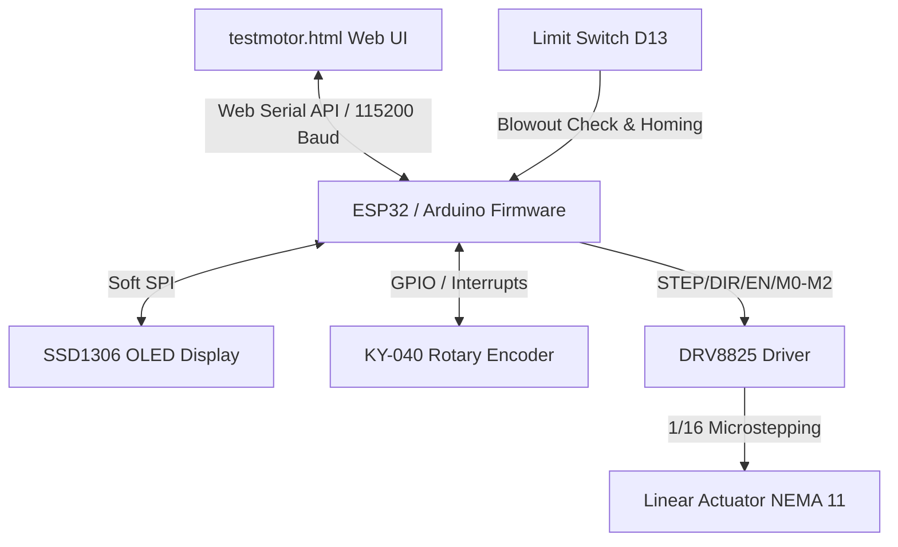
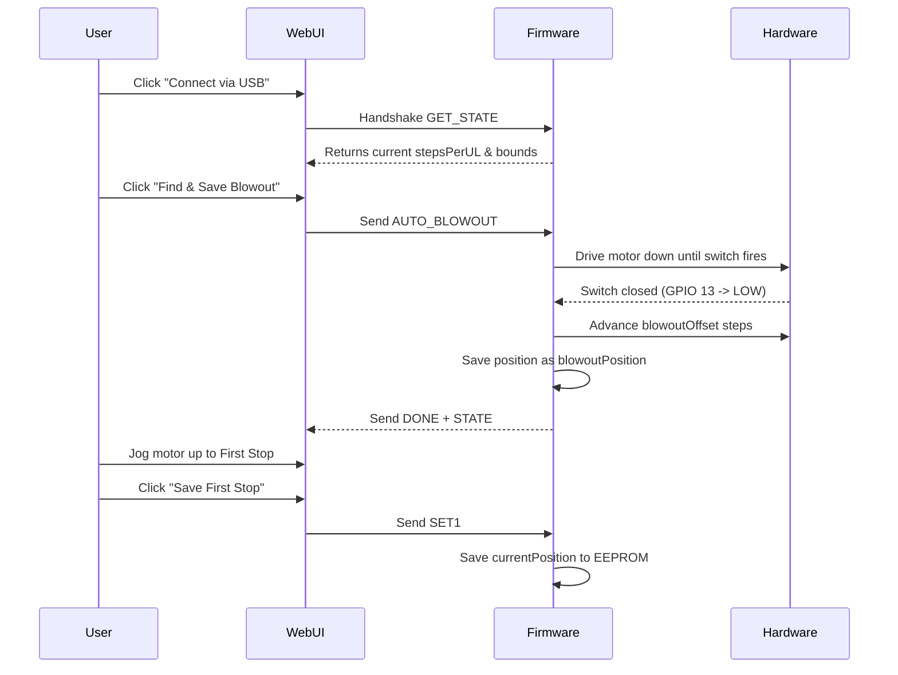

# Fluidrop Electronic Pipette: Comprehensive Technical Documentation

This document provides a complete technical breakdown of the Fluidrop electronic pipette system, covering the interaction between the **Firmware (Arduino C++)**, the **Frontend Control Interface (`testmotor.html`)**, and the underlying **Mechanical & Electronic subsystems**.

---

## 1. System Architecture Overview

The Fluidrop pipette operates as a hybrid control system. It can function **locally** (via an on-board OLED display, rotary encoder, and buttons) or **remotely** (via a web browser using the Google Chrome Web Serial API).



---

## 2. Hardware & Mechanical Subsystems

### 2.1 Stepper Motor & Linear Actuator
* **Actuation Mechanism:** A non-captive NEMA 11 stepper motor integrated with a lead screw acts as a linear actuator to push and pull the syringe plunger.
* **Microstepping Control:** Uses a **DRV8825** driver configured via microstepping pins `M0` (GPIO 25), `M1` (GPIO 33), and `M2` (GPIO 32). In `setup()`, the driver is set to **1/16 microstepping** (`setMicrostepping(16)`), providing high resolution (3200 steps/revolution) to accurately dispense sub-microliter volumes.

### 2.2 Position Reference Points
The actuator's travel is defined by three calibrated absolute positions (stored in steps):
1. **Home Position (`0`):** Plunger is fully retracted (topmost position).
2. **First Stop (`firstStopPosition`):** The transition point where the plunger has bypassed the air gap and is ready to aspirate liquid.
3. **Blowout (`blowoutPosition`):** The bottommost point of travel, used to purge any remaining droplets from the pipette tip.

### 2.3 Limit Switch (GPIO 13)
Mounted at the bottom of travel (near the blowout position). It serves two functions:
1. **Auto-Homing:** Provides a hardware reference point to find the blowout position and establish a coordinate coordinate frame.
2. **Real-time Drift Compensation:** If stepper motor steps are skipped due to mechanical resistance, the limit switch acts as a sanity check during dispensing. If it triggers at a different position than expected, the firmware dynamically offsets the stepper coordinates (`drift = switchHitPosition - expectedHit`) to recover accuracy.

### 2.4 KY-040 Rotary Encoder (GPIO 21, 22, 23)
* **CLK (GPIO 23) & DT (GPIO 22):** Quadrature encoder signals used to scroll through menu items or adjust volume parameters.
* **SW (GPIO 21):** Combined click switch. A short click selects an option or advances the pipetting step; a long press (>800ms) returns the interface to the main menu.

### 2.5 SSD1306 OLED Display
* **Communication Interface:** Software SPI (`SSD1306AsciiSoftSpi.h`) utilizing pins `CS=18`, `DC=5`, `RST=17`, `MOSI=16`, `CLK=4`.
* **State Updates:** To prevent flickering, the screen only redraws when a state transition occurs or when `displayNeedsUpdate` is explicitly flagged.

---

## 3. Firmware Architecture (Arduino C++)

The firmware is designed around a non-blocking asynchronous structure using the `AccelStepper` library.

### 3.1 Non-Volatile Memory (EEPROM Map)
Settings are saved to the ESP32 flash-emulated EEPROM (512 bytes) using absolute byte addresses:
* `ADDR_FIRST_STOP (0)`: First stop position coordinate (4-byte long).
* `ADDR_BLOWOUT (4)`: Blowout limit coordinate (4-byte long).
* `ADDR_STEPS_PER_UL (8)`: Resolution factor (4-byte float).
* `ADDR_MAX_CAPACITY (12)`: Syringe physical volume limit (4-byte float).
* `ADDR_DECEL (20)`: Acceleration/deceleration rate (4-byte float).
* `ADDR_SPEED (186)`: Maximum speed in steps/s (4-byte float).
* `ADDR_CAL_POINTS (26)`: Multi-point correction lookup array (160 bytes).

### 3.2 Web Serial Command Interface
In `loop()`, commands incoming from the Web UI are read via `Serial.readStringUntil('\n')` and parsed:

| Command | Action | Description |
| :--- | :--- | :--- |
| `GET_STATE` | Status Query | Emits positions, speed, decel, and steps/µL multiplier |
| `PREP` | Absolute Jog | Moves motor to `firstStopPosition` |
| `ASP` | Absolute Jog | Moves motor to `homePosition` (0) |
| `BLOWOUT` | Absolute Jog | Moves motor to `blowoutPosition` |
| `DISP` | Active Dispense | Moves to blowout while active-monitoring limit switch drift |
| `VOL:<vol>` | Absolute Aspirate | Moves to calculated step location for target volume |
| `DISP_VOL:<vol>` | Relative Dispense| Moves forward by the step value equivalent to target volume |
| `AUTO_HOME` | Calibrate | Runs homing sequence to align coordinates |
| `ADD_CAL:<t>,<m>` | Calibrate | Adds a target vs measured calibration point |

### 3.3 Multi-Point Calibration (Linear Interpolation)
To correct for structural non-linearity in syringe barrels, the firmware implements a piece-wise linear interpolation curve:
$$\text{Correction Factor} = \frac{\text{Target Volume}}{\text{Measured Volume}}$$
When `applyCalCorrection(vol)` is called, the firmware looks up the two target volumes bounding the requested volume, calculates the ratio, and interpolates:
```cpp
float t = (vol - calPoints[i].target) / (calPoints[i+1].target - calPoints[i].target);
float corrA = calPoints[i].target / calPoints[i].measured;
float corrB = calPoints[i+1].target / calPoints[i+1].measured;
return vol * (corrA + t * (corrB - corrA));
```

---

## 4. Frontend Architecture (`testmotor.html`)

The frontend is a single-page HTML5 application built using the Web Serial API to establish raw serial streams directly between the browser and the ESP32.

### 4.1 Web Serial Connection & Telemetry Sync
* **Connection Lifecycle:** When the user clicks "Connect via USB", `connectToPort()` requests the hardware port and establishes Decoders and Encoders. 
* **Auto-Connect:** Remembers the last connected device in `localStorage`. If `chkAutoConnect` is active, the app automatically establishes a serial session on page load.
* **Handshake Sequence:** Upon connecting, the app waits 2 seconds (bypassing the Arduino bootloader delay) and transmits `GET_FACTOR`, `GET_STATE`, and `GET_CAL`. The incoming stream is processed inside `readLoop()` to update sliders, multipliers, and configuration values.

### 4.2 Operating Modes
The UI provides three operation profiles, switching states when the **Spacebar** is pressed:

#### 1. Full Volume Stroke
Cycles between `firstStopPosition` and `blowoutPosition` to aspirate and dispense the maximum volume of the syringe:
* **State 0:** Pressing Spacebar sends `PREP` (moves to First Stop).
* **State 1:** Pressing Spacebar sends `ASP` (draws full volume).
* **State 2:** Pressing Spacebar sends `DISP` (purges liquid to blowout).
* **State 3:** Pressing Spacebar sends `PREP` (returns to ready).

#### 2. Custom Aliquot Repetition (Multi-Dispense)
Allows the user to draw a large volume and dispense it in smaller fractional aliquots:
* **State 1:** Pressing Spacebar sends `VOL:<total_vol>` to aspirate the bulk liquid.
* **State 2:** Successive Spacebar presses send `DISP_VOL:<aliquot_vol>`, updating `containedVolume` locally. 
* **State 3:** Once `containedVolume` is exhausted, the final Spacebar press triggers `DISP` to blowout any remaining fluid.

#### 3. Variable Pipette Mode
Designed for high-precision single volume dispenses:
* **State 1:** Pressing Spacebar sends `VOL:<var_vol>` to draw the precise volume.
* **State 2:** Pressing Spacebar sends `DISP` to purge to blowout.
* **State 3:** Pressing Spacebar sends `PREP` to return to ready.

---

## 5. Walkthrough of Interactive Workflows

### 5.1 Initial Calibration Sequence


### 5.2 Performing a Variable Pipette Cycle (OLED vs. Web UI)

#### Via Local OLED Menu:
1. Turn the **Rotary Encoder** to select `Variable` on the main menu, and click the knob.
2. Rotate the encoder to adjust the target volume (e.g., `50.0 µL`).
3. Click the knob once: Screen shows `Aspirating...` while the motor moves back to `firstStopPosition - (50 * stepsPerUL)`. Once finished, the screen updates to `FULL`.
4. Immerse tip in target vial and click the knob: Screen shows `Dispensing...` while the motor drives down to `blowoutPosition`. Once finished, screen updates to `EMPTY`.
5. Remove tip and click the knob: Screen shows `Returning...` and resets the plunger to `firstStopPosition`, updating state to `READY`.

#### Via Web UI:
1. Select **Variable Pipette Mode** in the Protocol Configuration card.
2. Enter the target volume (e.g., `50 µL`).
3. Position nozzle in liquid, then press **Spacebar**: Action Hero card flashes blue, motor moves to target, and UI updates to "Dispense Liquid".
4. Position nozzle in output vial, then press **Spacebar**: Action Hero card flashes pink, motor drives to blowout, and UI updates to "Return to 1st Stop".
5. Press **Spacebar** to return to ready.
